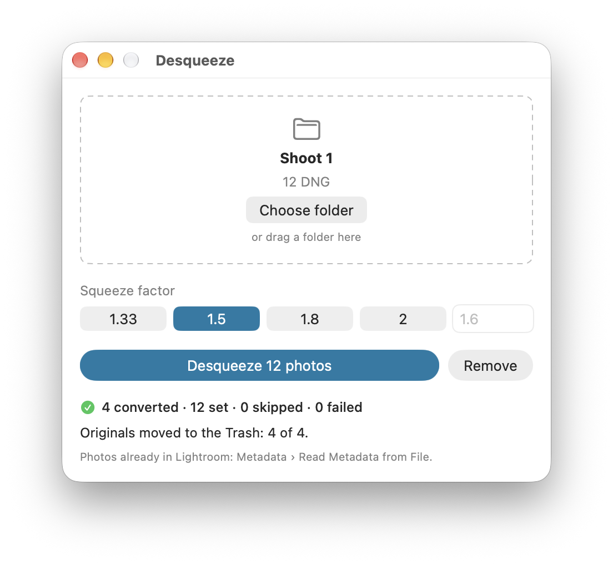

# Plateworks Desqueeze

A small Mac tool for photographers who shoot stills through an anamorphic
lens. The lens squeezes each photo. Desqueeze sets the `DefaultScale` tag in
every DNG in a folder, so Lightroom and Camera Raw show each photo at its
correct shape. It converts Sony ARW files to DNG first, because the tag works
only in a DNG.

No pixel changes. The tag is one small value in the file, and Remove sets it
back to no stretch.

<picture>
  <source media="(prefers-color-scheme: dark)" srcset="Sources/DesqueezeCore/DesqueezeCore.docc/Resources/window-result~dark@2x.png">
  
</picture>

There are three ways to use it, and all three do the same work: a window, a
command line tool named `desqueeze`, and an MCP server named `desqueeze-mcp`
for Claude Code. The code is Swift: one package with all the rules,
`DesqueezeCore`, and three thin front ends.

Version 0.1.2. The window has a download: a signed, notarized disk image,
with exiftool and dnglab inside the app. The section "Download" says what it
holds. The command line tool and the MCP server are a build from source.

## Is it for you

It is for you when all of these are true:

- You use Lightroom or Camera Raw. Finder and Quick Look ignore the tag, so
  their previews stay squeezed. Other raw editors were not tested.
- Your photos are DNG files from any camera, or ARW files from a Sony camera.
- Your lens squeezes the width, by a factor from 1 to 4.
- You have a Mac. The download needs Apple silicon and macOS 14 or later.
  A build from source needs Xcode. Both were tested on macOS 27.2 only, and
  the build with Xcode 27 only.

What it does not do:

- It does not stretch pixels or export an image. It sets a tag.
- It does not read subfolders. It works on the top level of one folder.
- It does not convert raw files other than Sony ARW.
- It does not set a vertical stretch.

## What it needs

This section is for a build from source. The app of the download has
exiftool and dnglab inside, and needs nothing more.

| Program | Needed for | Install |
|---|---|---|
| exiftool | Everything. It reads and writes the tags. | `brew install exiftool` |
| dnglab | The conversion of ARW files to DNG | `brew install dnglab` |
| Adobe DNG Converter | Optional. A backup for photos that dnglab cannot match. | A download from Adobe, installed in the Applications folder |
| Xcode | The build | The Mac App Store |
| XcodeGen | The build of the window | `brew install xcodegen` |

Adobe DNG Converter is not part of this project. The app does not contain
it, and you do not need it. With no converter at all, Desqueeze still sets
the tag on the DNG files that you have, and leaves the ARW files alone.

The build needs a Swift compiler of version 6.1 or later: the manifest of
the MCP server, `MCPServer/Package.swift`, asks for it. The manifest of the
root package asks for 5.9. The window is built in the Swift 6 language mode,
which `project.yml` sets. Everything was built and tested with Swift 6.4 and
Xcode 27 only. The section "Built and tested on" has each version.

Where each front end looks for the programs:

- **exiftool and dnglab, the window.** First inside its own app. The app of
  the download has both programs there, and an app that you built from
  source has none. Then `/opt/homebrew/bin`, then `/usr/local/bin`, then
  each folder of `PATH`. A window that Finder starts gets a short `PATH`,
  so on the Mac it finds the two programs in the two Homebrew folders only.
  The exiftool inside the app is a Perl script: the window takes it only
  when the Perl of macOS, `/usr/bin/perl`, can be run.
- **exiftool and dnglab, the command line tool and the MCP server.** On the
  Mac only: `/opt/homebrew/bin`, then `/usr/local/bin`, then each folder of
  `PATH`.
- **Adobe DNG Converter.** The window asks macOS where the app is, so it
  finds it wherever it is installed. The command line tool and the MCP
  server look in the Applications folder only.

The app of the download always uses the two programs inside itself. You
cannot make it use another copy. That is on purpose: the versions inside are
the tested ones.

## One camera is measured

A DNG from dnglab and a DNG from Adobe DNG Converter do not render the same.
Adobe writes values that dnglab does not: the white level, the baseline
exposure, the camera calibration, and the noise values. Desqueeze writes
Adobe's values into the dnglab DNG, so the two render alike. The renders
were compared in Camera Raw.

Those values were measured for one camera only: the **Sony A7S III**
(ILCE-7SM3), firmware 5.00, compressed raw, at ISO 50 and at 22 ISO settings
from 80 to 12800. ISO 1250 was not measured. The match needs a lens that does not report itself to the
camera, as an adapted anamorphic lens does not.

For any other ARW, this happens:

| Installed | What Desqueeze does |
|---|---|
| dnglab and Adobe DNG Converter | Adobe DNG Converter converts that photo. The DNG is the file that Adobe makes. |
| dnglab only | dnglab converts the photo. The shape is correct. A note says what the DNG lacks: for most such photos, the levels are dnglab's own. |
| Adobe DNG Converter only | Adobe DNG Converter converts every photo. |

A matched render is close to Adobe's and is not bit-identical to it. The
design has the measurements, in section 13.2. To add your camera, read
`CONTRIBUTING.md`.

The tag itself does not depend on the camera. A DNG that you have already
gets the correct shape, whatever camera made it.

## Download

Get the disk image of the newest release from the Releases page of the repo
on GitHub: <https://github.com/domalhambra/plateworks-desqueeze/releases>.
The first release is version 0.1.0, of 2026-10-12. Version 0.1.1, of the
same day, gives the app its accent and its icon, and version 0.1.2 draws
the icon again.

`scripts/make_release.sh` makes the download. It is one disk image.

| | What the script makes |
|---|---|
| File | `Desqueeze-<version>.dmg` |
| Holds | Desqueeze.app, and a link to the Applications folder |
| Inside the app | exiftool 13.55 and dnglab 0.8.0. You install nothing more. |
| Signature | Developer ID, with the hardened runtime. Notarized by Apple. The ticket is stapled to the app and to the disk image, so the first start needs no network connection. |
| Mac | Apple silicon, with macOS 14 or later. On an Intel Mac the app does not start. |

To install from a disk image, open it and drag Desqueeze to the Applications
folder.

- The download holds the window only. The command line tool and the MCP
  server stay a build from source, and they use the exiftool and the dnglab
  of the Mac.
- Adobe DNG Converter is never inside. Its license does not allow that, and
  the app works with no copy of it.
- The exiftool inside needs the Perl of macOS, `/usr/bin/perl`.
- The app has no update check, and it makes no network connection. So it
  cannot say that a new release exists: look at the Releases page.
- `SECURITY.md` says how to check a download.
- `THIRD_PARTY_NOTICES.md` has the licenses of the two programs inside. The
  app holds the license texts too.

## Install and run

Try it on a copy of a folder first. All commands run from the repo root.

### The window

This is the build from source. The app that it makes has no program inside,
so it uses the exiftool and the dnglab that Homebrew installed.

```bash
brew install exiftool dnglab xcodegen
xcodegen generate
xcodebuild -project PlateworksDesqueeze.xcodeproj -scheme PlateworksDesqueeze -configuration Release -derivedDataPath build build
cp -R build/Build/Products/Release/Desqueeze.app /Applications/
```

The build signs the app for the Mac that built it. It is not signed with a
Developer ID and it is not notarized.

1. Open Desqueeze.
2. Drop a folder of photos on the window, or click "Choose folder".
3. Select the squeeze factor of the lens: 1.33, 1.5, 1.8 or 2, or type one.
   The first time, 1.5 is selected. After that, the window starts with the
   factor of the last run.
4. Click the button that reads "Desqueeze", with the count of photos. The
   window shows the progress, then the counts and a line for each file that
   has something to say.

"Remove" sets every DNG in the folder back to no stretch. For photos that
are in Lightroom already, select them there and use Metadata › Read Metadata
from File.

For a folder with ARW files to convert, the window has a box: "Move the
original ARW files to the Trash". It is off each time. Tick it for one run,
and the run moves each ARW that it converted to the Trash, after the DNG of
that ARW passed a check. The section "What happens to your files" has the
rule.

### The command line tool

```bash
brew install exiftool dnglab
swift build -c release
.build/release/desqueeze --help
```

Copy the tool to a folder on your `PATH`, for example:

```bash
mkdir -p ~/.local/bin
cp .build/release/desqueeze ~/.local/bin/
```

`~/.local/bin` must be on your `PATH`. A new Mac does not have it there.
Add it in the start file of your shell, or copy the tool to a folder that
is on the `PATH` already.

```bash
desqueeze scan "/path/to/a folder"                         # what the folder holds. Changes no file.
desqueeze run "/path/to/a folder" --factor 1.5 --dry-run   # what a run would do. Changes no file.
desqueeze run "/path/to/a folder" --factor 1.5             # convert, then set the stretch
desqueeze remove "/path/to/a folder"                       # set every DNG back to no stretch
```

To move each converted ARW to the Trash in the same run, add
`--trash-originals`:

```bash
desqueeze run "/path/to/a folder" --factor 1.5 --trash-originals --dry-run   # shows a "trash" step for each ARW
desqueeze run "/path/to/a folder" --factor 1.5 --trash-originals
```

| Option | Does |
|---|---|
| `--factor <number>` | The squeeze factor, from 1 to 4. `run` needs it. There is no default. |
| `--dry-run` | For `run` and `remove`: lists what each file would get, and which converter gets each ARW. Changes no file. |
| `--no-convert` | For `run`: leaves the ARW files alone. |
| `--trash-originals` | For `run`: moves each original ARW to the Trash after its DNG passes the check. Off unless given. It does not go with `--no-convert`. |
| `--json` | Prints one JSON object on standard output, and nothing else there. |
| `--verbose` | Prints each exiftool and converter command, its exit code and its output on standard error. Also says when it removed a leftover work file. |

The exit code is 0 when the command completed and no file failed or was
blocked. It is 1 when a file failed or was blocked, or when the run was
stopped. It is also 1 when the folder could not be read, when a run met a
read-only folder, when another run works in the folder, and when exiftool is
missing. It is 2 for a wrong command line. Control-C stops a run after the
current file, and the tool still prints the result so far.

### The MCP server

```bash
brew install exiftool dnglab
swift build -c release --package-path MCPServer
MCPServer/.build/release/desqueeze-mcp --help
```

The first build fetches the MCP library for Swift, so it needs a network
connection. Copy the server to a folder of your choice, then give your MCP
client its absolute path. For Claude Code:

```bash
claude mcp add desqueeze -- /absolute/path/to/desqueeze-mcp
```

The server has three tools: `desqueeze_scan`, `desqueeze_run` and
`desqueeze_remove`. They do the work of the three commands above and return
the same JSON. A person does not type to the server.

The server never moves an original ARW to the Trash. It has no argument for
that, so an agent cannot remove your originals through the server. Only the
window and the command line tool can, on your request. One limit: an agent
that has a shell can start the command line tool with the flag.

### One run in a folder at a time

Only one run works in a folder at a time. A run holds a lock on the folder
until it ends. The lock makes no file. A second run in the same folder does
not start and changes nothing: from the window, from the tool, or from the
server. It says:

```
Another Desqueeze run is working in this folder. Wait for it to end, then run again.
```

The tool then gives the exit code 1, and the server gives a tool error. A
scan and a dry run take no lock. While a run works, they can show a folder
in change: scan again after the run ends. On a volume that gives no such
lock, the run goes on without one, and its result says so. Do not start two
runs in one folder there.

### What happens to your files

- An ARW is never changed and never deleted. Its new DNG goes beside it,
  with the same base name.
- An ARW moves only on your request for one run: the box in the window, or
  `--trash-originals`. Then the run moves each ARW that it converted to the
  Trash. It first checks that the DNG is complete, that the DNG is the file
  that this run made and names that ARW, and that the ARW did not change
  during the run. When a check does not pass, or the Trash refuses the file,
  the ARW stays, and a note says why. A sidecar file, such as an XMP file,
  stays too. The limits of the checks:
  - The check does not decode the picture. Look at the DNG files in
    Lightroom before you empty the Trash.
  - The tool compares the size, the modification date and the file number of
    the ARW and of the DNG. It does not compare the bytes.
  - Another program can put a file at the name of the DNG in three short
    moments that the tool cannot see: directly after a conversion, while
    exiftool sets the stretch of that DNG (about a tenth of a second), and
    after the last read before the move.
  - The box, the run button and a dry run count from the last scan. The run
    scans again, so it can move more or fewer ARW files than they said.
  - A dry run lists a `trash` step for each ARW that it expects to convert.
    When a conversion then fails, that ARW stays.
- A converter writes a hidden work file beside the ARW, and the DNG gets its
  name only when it is complete. When a run ends hard, the hidden file can
  stay. The next run moves it to the Trash before it converts that photo.
- Before exiftool writes a DNG, it keeps the earlier file as a backup. The
  backup goes to the Trash only after the new tag reads back correctly.
  Nothing is deleted.
- A DNG that got the tag is a new file. Finder shows the time of the run as
  its creation date, and Finder tags on the earlier file are gone. The
  capture date inside the photo does not change.
- The app makes no network request and collects no data.

## Prove a change

```bash
swift test
swift test --package-path MCPServer
xcodegen generate
xcodebuild -project PlateworksDesqueeze.xcodeproj -scheme PlateworksDesqueeze -derivedDataPath build test
```

The first command tests the core and the command line tool, and runs the
docs check. It needs `python3`. The second tests the MCP server. The last
two test the state of the window. They start no app and open no window.

Some tests run the real programs on one ARW and one DNG in `fixtures/`. That
folder is not in the repo, because the photo is private. Make it with one
ARW of your own:

```bash
scripts/make_fixtures.sh "/path/to/one file.ARW"
```

The script makes the DNG with Adobe DNG Converter. When that is not
installed, it makes the DNG with dnglab and exiftool. With neither, it stops
before it copies a file. Any Sony ARW that dnglab and Adobe DNG Converter can
read works: a test takes each value that it expects from the frame itself.
A test skips, and does not fail, when what it needs is absent:

| Absent | What skips |
|---|---|
| `fixtures/` | Every test on the real programs, and the end-to-end tests of the tool and of the server that run on a photo |
| dnglab | The tests of the real dnglab conversion, and the drift check |
| Adobe DNG Converter | The tests of the real Adobe conversion, the tests of the real exiftool in `Tests/DesqueezeCoreTests/IntegrationTests.swift`, the drift check, and the end-to-end tests that run on a photo |
| A frame that the match table covers (the section "One camera is measured") | The drift check, and the tests of the real dnglab match |

Never test on a real shoot folder. Copy it first.

## Ship it

The window has a download on the Releases page of the repo on GitHub. The
command line tool and the MCP server are a build from source, as above.

`scripts/make_release.sh` makes the release, on the one Mac that has the
Developer ID. It builds the app for Apple silicon, puts exiftool and dnglab
inside with their license texts, signs, notarizes, and makes the disk image.
It uploads nothing: the maintainer publishes a release by hand. GitHub
Actions makes no release.

```bash
scripts/make_release.sh --local   # the app only, signed ad hoc, for checks
scripts/make_release.sh           # the signed, notarized disk image
```

`--local` needs no Developer ID. It puts the app in the folder release
inside build, which git ignores. That app is for checks, and for the Mac
that built it.

The copies of the two programs come from Homebrew on the Mac that makes the
release. The script holds the version of each one and the SHA-256 of its
files, and it stops when one differs. The design has the contract, in
section 15. `docs/changing-things.md` has the steps: to cut a version, to
make a release, and to change a program inside the download.

## Built and tested on

| | Version |
|---|---|
| Mac | Apple silicon, macOS 27.2 |
| Xcode | 27.0 |
| Swift | 6.4 |
| XcodeGen | 2.44.1 |
| exiftool | 13.55 |
| dnglab | 0.8.0 |
| Adobe DNG Converter | 18.7 |
| The Perl of macOS, for the exiftool inside the app | 5.34.1 |

The deployment target is macOS 14. No other Mac, system or tool version was
tested.

The download: `scripts/make_release.sh` made versions 0.1.0, 0.1.1 and
0.1.2 on this Mac. For each, all eight steps passed: the signature with the
Developer ID, the notarization of the app and of the disk image, and the
stapled tickets. `spctl` accepted the app, the disk image, and the app
inside the disk image. For version 0.1.0, the app from the disk image then
converted copies of ARW files with the two programs inside it. For version
0.1.1, the app that the script makes with `--local` did that. Version
0.1.2 changes the icon only, and had no window trial. On
2026-10-12 the maintainer downloaded the disk image of version 0.1.1 with a
browser, opened it, and opened the app: the first open of a downloaded copy
works. On the same day the maintainer listened to the window with
VoiceOver through one run, and found no fault. Not tested: macOS 14 to 26,
and an Intel Mac, with the download or
with a build from source.

## Where to go next

| You want | Read |
|---|---|
| The rules that must not break, before you change code | `CLAUDE.md` |
| Which file owns what, and which test covers it | `docs/architecture.md` |
| The steps for one kind of change | `docs/changing-things.md` |
| To send a change, or to add a camera | `CONTRIBUTING.md` |
| What the app must do | `docs/superpowers/specs/2026-10-05-desqueeze-design.md` |
| Why something is the way it is | `docs/decisions.md` |
| Why the project exists and where it stands | `PROJECT_CHARTER.md` |
| To report a problem that can harm files | `SECURITY.md` |
| What the tool, the site and the download load and save | The privacy page, `Sources/DesqueezeCore/DesqueezeCore.docc/Privacy.md`. On the site it is at <https://domalhambra.github.io/plateworks-desqueeze/privacy/>. |
| Every document | `docs/README.md` |

## The documentation site

The guides for a photographer and for a contributor, and the API reference
of `DesqueezeCore`, are one DocC catalog:
`Sources/DesqueezeCore/DesqueezeCore.docc`. Build the site with
`scripts/build_docs.sh`. It needs Xcode, and it adds no dependency to the
package. The site is at <https://domalhambra.github.io/plateworks-desqueeze/>.
`.github/workflows/docs.yml` publishes it on each push to the main branch.

## License

MIT. Copyright (c) 2026 Plateworks. The text is in `LICENSE`.

exiftool, dnglab and Adobe DNG Converter are separate programs with their
own licenses. The app of the download holds a copy of exiftool and of
dnglab, with their license texts. The MCP server links libraries with their
own licenses. `THIRD_PARTY_NOTICES.md` lists all of them.
